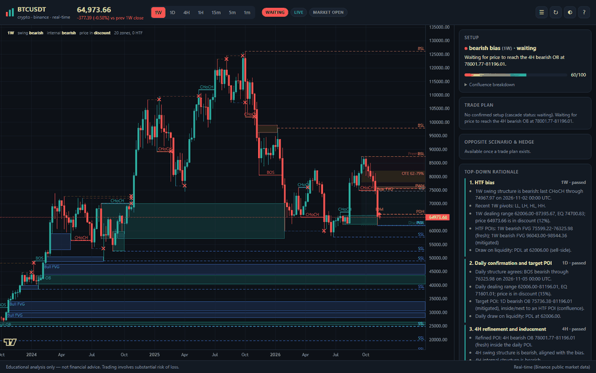
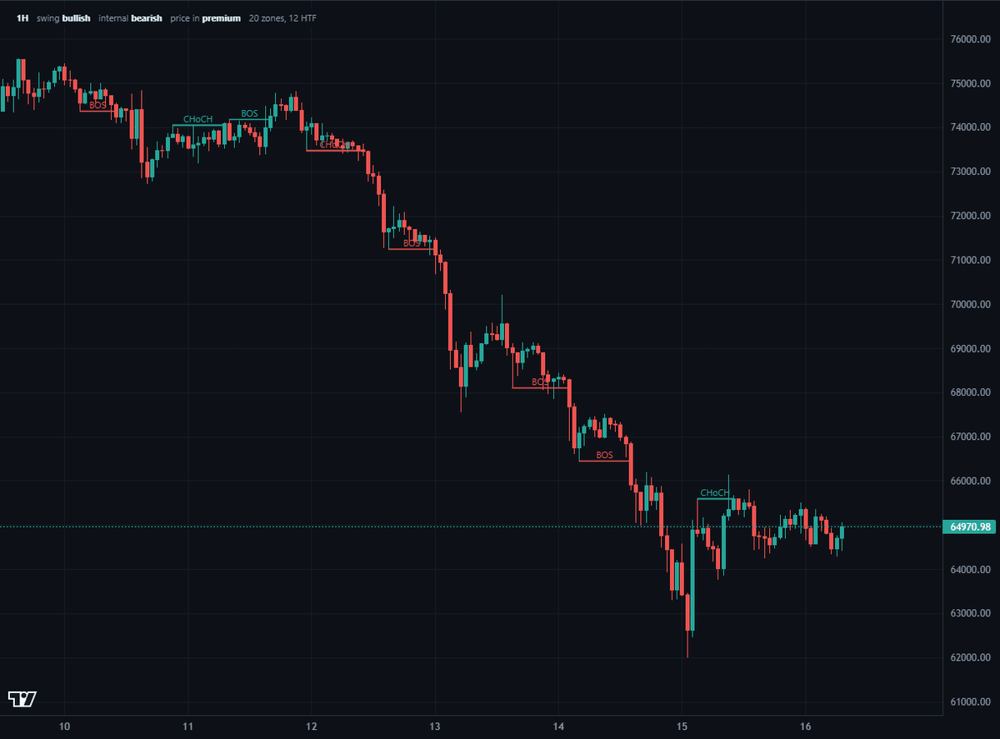
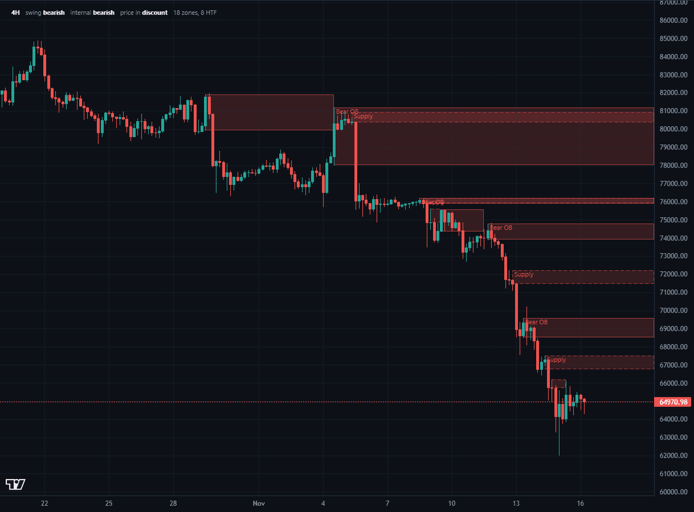
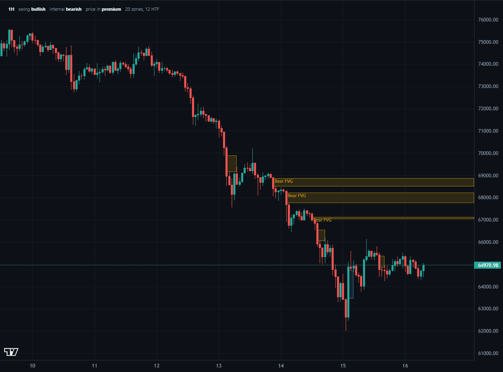
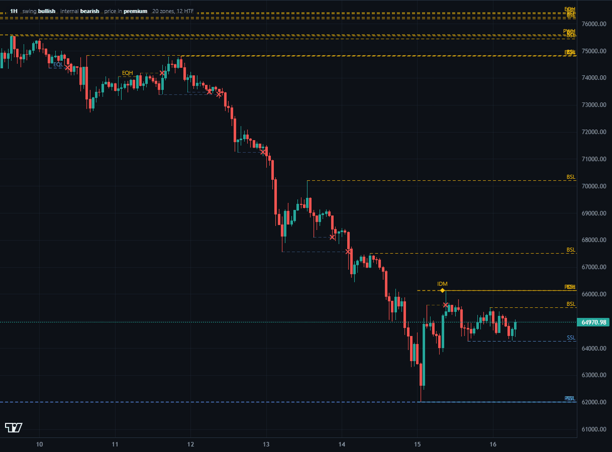
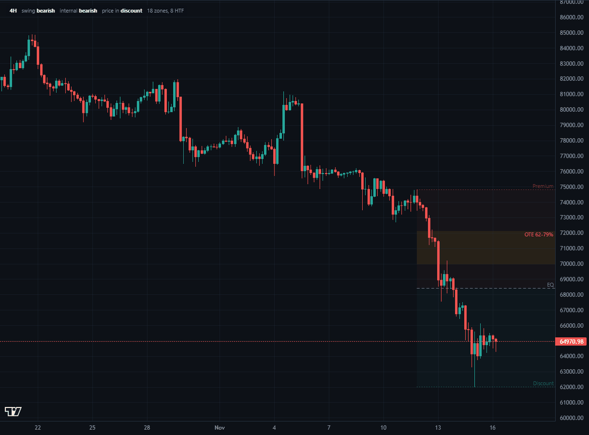
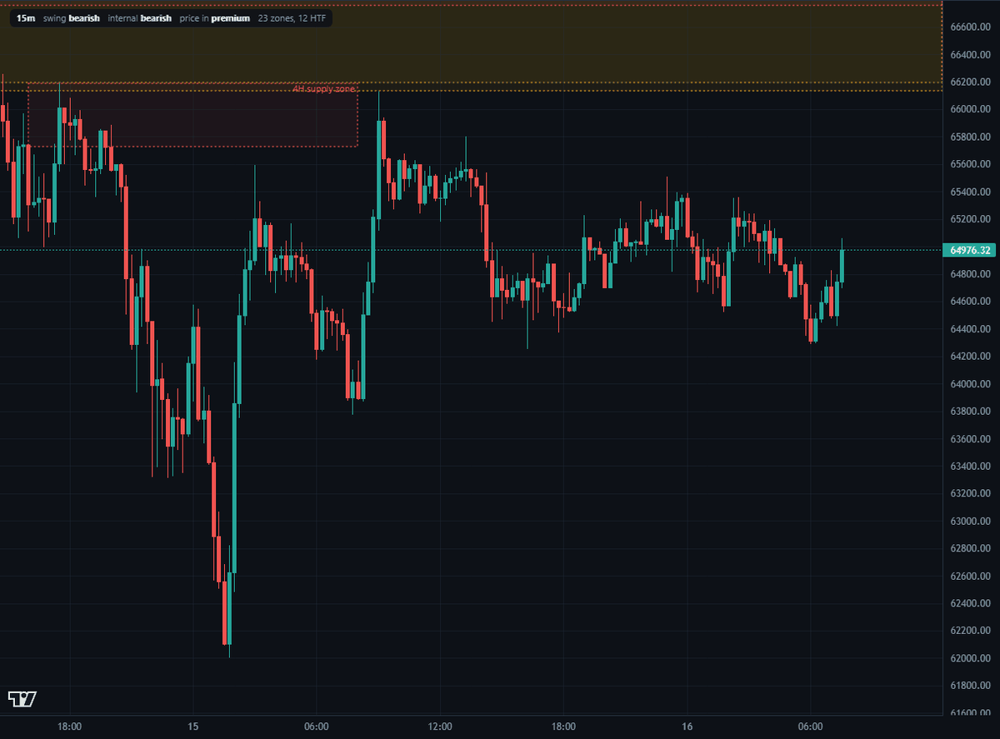
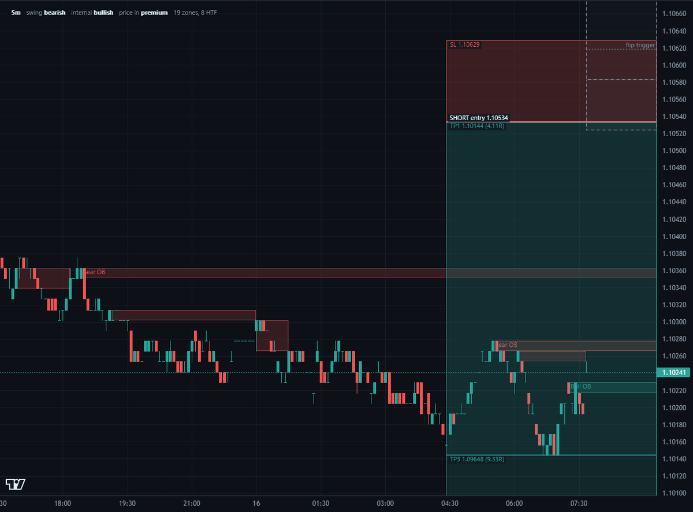
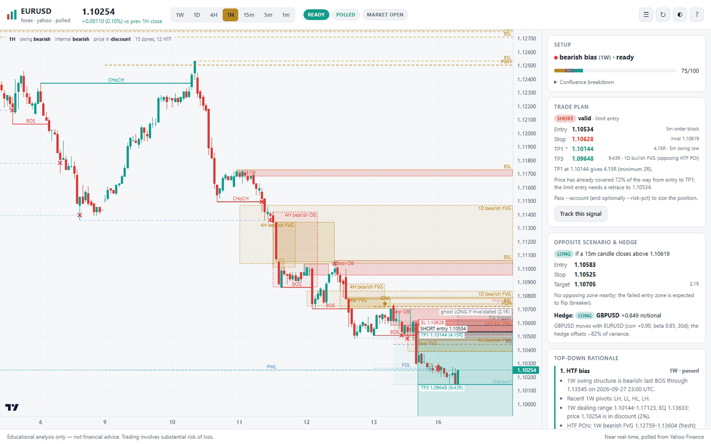
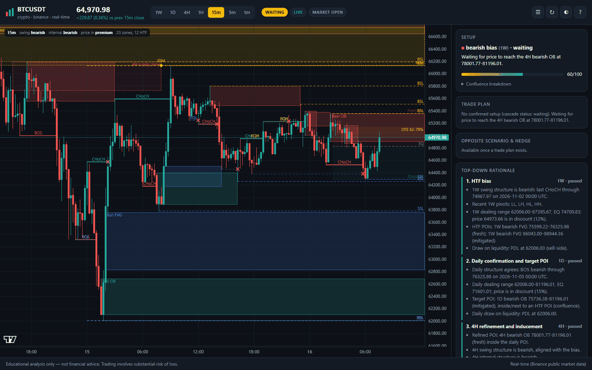

# SMC Analyst — Smart Money Concepts for Claude Code

> Ask Claude for a **top-down Smart Money Concepts (SMC / ICT)** analysis of any stock, crypto or forex pair. You get a structured report, a priced trade plan (or an honest *"no setup — waiting for X"*), and a **live candlestick dashboard** with every concept drawn on real-time candles.

[](https://github.com/atirek-pro/smc-analyst/actions/workflows/ci.yml)




---

## What it does

Say *"Do an SMC analysis on BTCUSDT"* and Claude:

1. **Reads the chart top-down, like a discretionary SMC trader.** It moves through five stages, and the gate rule stops at the first one that fails, so it never forces a trade:

   | Stage | Timeframe | Question |
   |---|---|---|
   | 1 | Weekly | What is the bias? Where are the HTF POIs and the draw on liquidity? |
   | 2 | Daily | Does it agree? Which POI sits in discount (longs) / premium (shorts)? |
   | 3 | 4H | Refine the POI; where is the inducement? |
   | 4 | 15m | Has price tapped the POI, swept liquidity and printed a CHoCH? |
   | 5 | 5m / 1m | Exact entry zone, invalidation, targets |

2. **Detects every concept:**
   - structure: swings, BOS / CHoCH (swing + internal)
   - liquidity: BSL / SSL, equal highs / lows, PDH / PDL / PWH / PWL, sweeps, inducement
   - zones: order blocks, fair value gaps, supply / demand, each tracked as fresh → mitigated → invalidated
   - premium / discount, EQ and OTE; ICT killzones

3. **Prices a trade plan:**
   - entry, stop loss and **TP1–TP3 with R:R**, rejected below 2R or if the move has already played out
   - **position sizing** (coins, shares, forex lots, ounces)
   - the **opposite-bias scenario** if the setup fails
   - a **correlation-based hedge**

4. **Opens a live dashboard** (TradingView Lightweight Charts) where everything above is drawn, from 1W to 1m, updating in real time.

5. **Tracks signals.** It follows each signal candle by candle (pending → triggered → TP1/TP2/TP3 or stop) in a journal with **hit rate and average R**, so you can see whether it works.

## Example prompts
- *Do a smart money concepts analysis on BTCUSDT*
- *SMC top-down on EURUSD for a 10k account risking 1%*
- *Any order-block setups on AAPL? Track the signal if it's valid.*
- *Analyse SOL* → Claude asks: *Solana (SOLUSDT) or the stock SOL?*
- *Compare XAUUSD, NAS100 and ETHUSDT*
- *How did my tracked signals do?* · *Stop the dashboard*

## Install

**Option A: skills CLI**
```bash
npx skills add atirek-pro/smc-analyst -a claude-code
```

**Option B: Claude Code plugin marketplace**
```text
/plugin marketplace add atirek-pro/smc-analyst
/plugin install smc-analyst@smc-analyst-marketplace
```

**Requirements:**
- Python **3.12+**. On first use the skill builds its own isolated virtualenv; this is a one-time install of a few minutes.
- Internet access for market data. **No API keys.**

## Screenshots

| | |
|---|---|
|  **Market structure:** BOS / CHoCH, HH/HL labels |  **Order blocks** and supply / demand, ending on mitigation |
|  **Fair value gaps** |  **Liquidity:** BSL/SSL, EQH/EQL, PDH/PDL, ✕ sweeps, inducement |
|  **Premium / discount**, EQ and OTE |  **Weekly / daily / 4H POIs** projected onto 15m |
|  **Trade plan:** entry, stop, TPs with R:R, ghost opposite scenario |  **Full dashboard,** light theme |



### Dashboard keys
`1`–`7` timeframes (1W → 1m) · `H` HTF zones on/off · `P` position tool · `L` layers · `F` fit · `R` refresh · `T` theme · `?` help.

Deep links: `?tf=4H&theme=light&layers=ob,fvg`.

## What a report looks like (excerpt)

```markdown
## SMC analysis — EURUSD (forex)
**Verdict:** 🔴 Bearish bias (1W) · **READY - confirmed setup** · confluence **75/100**
> **Valid SHORT setup:** TP1 at 1.10144 gives 4.11R (minimum 2R).

| | Price | R:R | Basis |
|---|---|---|---|
| Entry (limit) | 1.10534 | | 5m bearish OB 1.10534–1.10583 |
| Stop loss | 1.10629 | −1.00R | beyond invalidation 1.10619 + ATR buffer |
| TP1 ★ | 1.10144 | 4.11R | 15m swing low |
```

Full examples: [`tests/golden/analyze_ready.md`](tests/golden/analyze_ready.md) and [`tests/golden/analyze_waiting.md`](tests/golden/analyze_waiting.md).

## Symbols and data

| Asset class | Type it as | Source | Real-time? |
|---|---|---|---|
| Crypto | `BTCUSDT`, `btc/usdt`, `BTC`, `BINANCE:ETHUSDT` | Binance public API (mirror + Yahoo fallback) | **Yes**, WebSocket |
| Forex | `EURUSD`, `EUR/USD`, `FX:GBPJPY` | Yahoo Finance | Polled (~30 s) |
| Stocks | `AAPL`, `NASDAQ:SOL`, `RELIANCE.NS`, `NSE:RELIANCE` | Yahoo Finance | Polled; some exchanges delay 15–20 min |
| Indices | `SPX`, `NAS100`, `US30`, `DXY`, `NIFTY`, `DAX` | Yahoo Finance | Polled |
| Commodities | `XAUUSD`/`GOLD`, `XAGUSD`, `USOIL`, `UKOIL` | Yahoo futures (`GC=F` …) | Polled |

**Data limits:**
- Yahoo intraday history: 1m ≈ 7 days, 5m/15m ≈ 60 days.
- Metals and oil use futures as a spot proxy.
- Exchange holidays aren't modelled.
- Only crypto is tick-level real-time.

## Configuration
Defaults are in [`skills/smc-analyst/config.default.json`](skills/smc-analyst/config.default.json). Override any key in `skills/smc-analyst/config.json`, e.g. `{"trade": {"min_rr": 3}}`.

| Key | Default | Meaning |
|---|---|---|
| `structure.break_confirmation` | `body_close` | A break needs a candle **close** beyond the level (`wick` also allowed) |
| `swings.lookback` | 1W/1D 3 · 4H 4 · ≤1H 5 | Fractal pivot size per timeframe (`internal_lookback` 2) |
| `zones.displacement_body_atr` | `1.2` | An OB needs an impulsive candle ≥ 1.2 × ATR (or an FVG) |
| `liquidity.equal_level_tolerance_atr` | `0.1` | Equal highs/lows tolerance |
| `pd_array.ote` | `[0.62, 0.79]` | Optimal trade entry band |
| `trade.entry_mode` | `ob_edge` | Entry at the zone edge, or `ob_50` |
| `trade.sl_atr_buffer` | `0.25` | Stop buffer in ATR beyond invalidation |
| `trade.min_rr` | `2.0` | Minimum R:R for a valid plan |
| `risk.account_size` / `risk.risk_pct` | unset / `1.0` | Default position sizing |
| `hedge.min_abs_correlation` | `0.5` | Below this, no hedge is suggested |
| `tracker.signal_expiry_hours` | `48` | Pending signals expire after this |
| `data.poll_interval_seconds` | `30` | Polling for Yahoo symbols |
| `server.port_range` | `[8765, 8799]` | Dashboard ports (bound to 127.0.0.1 only) |

The exact rules are documented in [`references/`](skills/smc-analyst/references): methodology, top-down workflow, trade-plan rules, symbols and the report format.

## Command line (without Claude)
Run these with the skill's `.venv` Python (created by `scripts/setup.py`):

```bash
python skills/smc-analyst/scripts/analyze.py --symbol EURUSD --account 10000 --risk-pct 1   # markdown report
python skills/smc-analyst/scripts/analyze.py --symbol SOL --resolve                          # ambiguity check
python skills/smc-analyst/scripts/serve.py --symbol EURUSD --detach                         # live dashboard
python skills/smc-analyst/scripts/serve.py --stop
cd skills/smc-analyst/scripts && python -m smc.tracker --refresh                            # signal journal
```

## Project layout
```
.claude-plugin/            plugin + marketplace manifests, icon
skills/smc-analyst/
  SKILL.md                 the workflow Claude follows
  config.default.json      every tunable threshold
  references/              rules: methodology, workflow, trade plan, symbols, report format
  scripts/setup.py         isolated environment bootstrap
  scripts/analyze.py       single entry point: analysis + plan + report (JSON / markdown)
  scripts/serve.py         live dashboard server (FastAPI + WebSocket)
  scripts/smc/             engine: data, structure, liquidity, zones, cascade, plan, tracker, schema
  assets/dashboard/        chart UI (vanilla JS + Lightweight Charts 5.2.1, vendored)
tests/                     offline test suite incl. golden files
tools/make_media.py        regenerates the screenshots and GIF from the live dashboard
```

## Development
```bash
python -m venv smc-skill-env && source smc-skill-env/bin/activate   # Windows: smc-skill-env\Scripts\activate
pip install -r requirements-dev.txt
python -m pytest                       # offline test suite (also run in CI on Linux / Windows / macOS)
python -m ruff check .                 # lint
SMC_UPDATE_GOLDEN=1 python -m pytest tests/test_golden.py   # accept an intended report / JSON change
python tools/make_media.py             # refresh README media (needs Edge or Chrome)
claude --plugin-dir .                  # try the skill locally
```

See [CHANGELOG.md](CHANGELOG.md) for the history and [RELEASING.md](RELEASING.md) for the release checklist.

## Roadmap
- **API-key data feeds:** OANDA / Polygon / Twelve Data for real-time forex, stocks and indices.
- **Backtester:** replay the cascade over history to measure hit rate and expectancy per symbol and timeframe.
- **Alerts:** notify when a setup moves to `in_poi` / `ready`, or when a tracked signal hits a target or stop.
- More concepts: breaker and mitigation blocks, SMT divergence, session (Asia) range liquidity on the chart.
- Multi-symbol watchlist dashboard.

## Disclaimer
**Educational analysis only. Not financial advice.** SMC is a discretionary methodology; this tool applies one consistent, rules-based reading of it, which won't match every trader's markup. Markets are risky, and you can lose more than you expect. You are solely responsible for your trading decisions.

## License and credits
- [MIT](LICENSE) © smc-analyst contributors.
- Charts by [TradingView Lightweight Charts™](https://github.com/tradingview/lightweight-charts) (Apache-2.0, vendored with its license).
- Market data from Binance public endpoints and Yahoo Finance via [yfinance](https://github.com/ranaroussi/yfinance).
