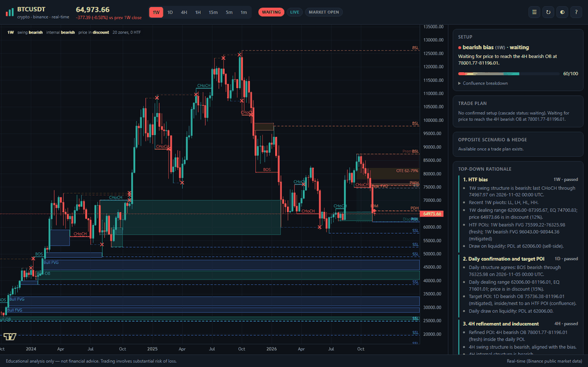

# smc-analyst v1.0.0 — first stable release

Top-down **Smart Money Concepts (SMC / ICT)** analysis for Claude Code. Ask for an analysis of any stock, crypto or forex pair. You get a stage-by-stage report, a priced trade plan (or an honest *"no setup — waiting for X"*), and a **live candlestick dashboard** with every concept drawn on real-time candles.



## Install
```bash
npx skills add atirek-pro/smc-analyst -a claude-code
```
or, in Claude Code:
```text
/plugin marketplace add atirek-pro/smc-analyst
/plugin install smc-analyst@smc-analyst-marketplace
```
Then ask: *"Do a smart money concepts analysis on BTCUSDT"*. Requires Python 3.12+ and no API keys.

## Highlights
- **Top-down cascade, like a discretionary trader:** Weekly bias → Daily POI in discount/premium → 4H refinement and inducement → 15m tap, sweep and CHoCH → 5m/1m entry. A **gate rule** stops at the first failing stage and names what it's waiting for.
- **Every SMC concept:**
  - BOS / CHoCH (swing + internal), equal highs/lows, BSL/SSL, PDH/PDL/PWH/PWL, sweeps, inducement
  - order blocks, FVGs, supply/demand with mitigation states; premium/discount, EQ, OTE; killzones
  - all on closed candles, with no look-ahead
- **Trade plan:**
  - entry, stop (ATR-buffered) and TP1–TP3 with R:R; rejected below 2R or when the move has already played out
  - position sizing (coins, shares, forex lots with FX conversion, ounces)
  - opposite-bias scenario; correlation/beta hedge (suppressed when correlation is weak)
- **Live dashboard:**
  - FastAPI + WebSocket server, TradingView Lightweight Charts
  - 1W–1m switcher; layer toggles; HTF POIs projected onto lower timeframes
  - position tool + ghost scenario; dark/light themes; keyboard shortcuts; deep links
  - runs detached, so it survives the Claude turn
- **Signal tracking:** pending → triggered → TP1/TP2/TP3 / stop / breakeven / expired, using a conservative scale-out model. It catches up after restarts and reports hit rate and average R.
- **Claude workflow:** asks about ambiguous symbols (`SOL`: coin or stock?), sets up its own isolated venv, runs one command (`analyze.py`), presents the report verbatim, and launches the dashboard.

## Quality
- **267 offline tests:** detectors, cascade gates, plan math, tracker state machine, API/WebSocket, CLI, golden files.
- **CI** on Linux, Windows and macOS; ruff lint; a JSON contract (`smc/schema.py`).
- **Verified end to end** with real headless Claude Code sessions and real market data. Every Phase 3–6 logic issue found that way was fixed (see the CHANGELOG).

## Known limitations
- Rules-based reading of SMC: consistent, but it won't match every trader's markup.
- Stocks, forex and indices are polled from Yahoo Finance (about 30 s; some exchanges delay 15–20 min). Only crypto is tick-level real-time.
- Yahoo intraday history: 1m ≈ 7 days, 5m/15m ≈ 60 days. Futures stand in for spot metals and oil. Exchange holidays aren't modelled.

**Educational analysis only — not financial advice.**
